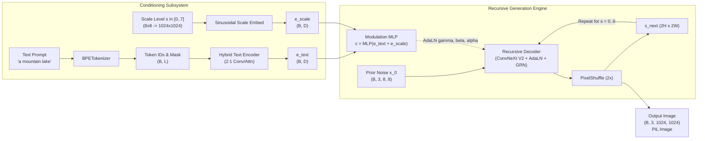

# ScaleFlow: Recursive Multiscale Flow Matching for Image Generation

[]()
[]()
[]()
[]()

**ScaleFlow** is a modern, modular, and lightning-fast deep learning library implementing **Recursive Multiscale Optimal Transport Conditional Flow Matching (OT-CFM)** for text-to-image synthesis in PyTorch.

Instead of generating images at full resolution via dozens of flat denoising steps, ScaleFlow recursively flows through a multi-resolution pyramid: starting from an ultra-compact $8 \times 8$ noise prior and progressing sequentially through 7 recursive scale stages ($8 \to 16 \to 32 \to 64 \to 128 \to 256 \to 512 \to 1024$), drastically improving convergence speed, visual coherence, and computational efficiency.

---

## Table of Contents

- [Key Architectural Highlights](#key-architectural-highlights)
- [System Architecture](#system-architecture)
  - [End-to-End Pipeline Workflow](#end-to-end-pipeline-workflow)
  - [Recursive Multiscale Trajectory](#recursive-multiscale-trajectory)
- [Installation](#installation)
- [Quickstart Guide](#quickstart-guide)
  - [1. Text-to-Image Generation](#1-text-to-image-generation)
  - [2. Multiscale Pyramid Generation](#2-multiscale-pyramid-generation)
  - [3. Classifier-Free Guidance (CFG)](#3-classifier-free-guidance-cfg)
- [Training with Multiscale OT-CFM](#training-with-multiscale-ot-cfm)
  - [1. Synthetic Dataset Toy Training](#1-synthetic-dataset-toy-training)
  - [2. Training on Custom Image-Text Datasets](#2-training-on-custom-image-text-datasets)
- [Core Modules & API Reference](#core-modules--api-reference)
  - [`scaleflow.tokenizer.BPETokenizer`](#scaleflowtokenizerbpetokenizer)
  - [`scaleflow.models.ScaleFlowModel`](#scaleflowmodelsscaleflowmodel)
  - [`scaleflow.pipeline.ScaleFlowPipeline`](#scaleflowpipelinescaleflowpipeline)
  - [`scaleflow.training.MultiscaleOTFlowMatching`](#scaleflowtrainingmultiscaleotflowmatching)
  - [`scaleflow.training.ScaleFlowTrainer`](#scaleflowtrainingscaleflowtrainer)
- [Mathematical Formulation](#mathematical-formulation)
- [Repository Structure](#repository-structure)
- [Verification & Test Suite](#verification--test-suite)
- [License](#license)

---

## Key Architectural Highlights

1. **Zero-Dependency BPE Tokenizer (`scaleflow.tokenizer.BPETokenizer`)**:
   - Clean, pure Python/PyTorch subword tokenizer with Byte-Pair Encoding merges.
   - Full support for special tokens (`<pad>: 0`, `<bos>: 1`, `<eos>: 2`, `<unk>: 3`).
   - PyTorch batch tensor formatting with dynamic padding and attention masks.
   - Lossless roundtrip encoding/decoding and standalone JSON serialization.

2. **LFM2-Style Hybrid Text Encoder (`scaleflow.models.HybridTextEncoder`)**:
   - Combines 1D Depthwise Gated Convolutions (local n-gram context) with Multi-Head Self-Attention (global semantic relations) in a 2:1 block ratio.
   - Attention-masked sequence processing and mean pooling to produce compact conditioning vectors $e_{\text{text}} \in \mathbb{R}^D$.

3. **Sinusoidal Scale Embedding (`scaleflow.models.SinusoidalScaleEmbedding`)**:
   - Continuous frequency representations for discrete pyramid scale indices $s \in [0..7]$ corresponding to spatial resolutions $2^{s+3} \times 2^{s+3}$ ($8 \times 8$ up to $1024 \times 1024$).

4. **Recursive ConvNeXt V2 Decoder (`scaleflow.models.ScaleFlowDecoder`)**:
   - Depthwise $7 \times 7$ convolutions with inverted bottleneck expansion.
   - **AdaLN (Adaptive Layer Normalization)** modulation conditioned on $c = \text{MLP}(e_{\text{text}} + e_{\text{scale}})$.
   - Global Response Normalization (GRN) and GELU activations.
   - Sub-pixel $2\times$ PixelShuffle upsampler head.

5. **Scale-Aware Cross-Attention (`scaleflow.models.decoder.ScaleAwareCrossAttention`)**:
   - Multi-head spatial cross-attention between visual feature maps and text token sequences ($L \times D$).
   - Active only at semantic coarse-to-medium resolutions ($s \le 3$, covering $\le 64 \times 64$) with zero-initialized residual gating.
   - Completely bypassed with zero compute overhead at high resolutions ($128 \times 128$ to $1024 \times 1024$) where pixel counts dominate.

6. **Multiscale Optimal Transport Conditional Flow Matching (`scaleflow.training`)**:
   - Dynamic downsampled image pyramids.
   - Straight-line probability paths $x_t = (1 - (1 - \sigma_{\min})t)x_0 + t x_1$ with constant target velocity $v_t = x_1 - (1 - \sigma_{\min})x_0$.
   - Scale-conditioned loss weighting and cosine similarity velocity metrics.

7. **High-Level User Pipeline (`scaleflow.pipeline.ScaleFlowPipeline`)**:
   - Simple Hugging Face-style interface: `.from_pretrained()`, `.to(device)`, and `__call__()`.
   - Native support for PIL images, PyTorch tensors, multiscale pyramids, and CFG.

---

## System Architecture

### End-to-End Pipeline Workflow



### Recursive Multiscale Trajectory

ScaleFlow solves a sequence of short Optimal Transport flow segments across increasing spatial resolutions:

```
[s=0: 8x8] -----> [s=1: 16x16] ----> [s=2: 32x32] ----> [s=3: 64x64]
Noise Prior       Coarse Layout      Shapes & Masses    Contours & Shading
     |
     v
[s=4: 128x128] -> [s=5: 256x256] -> [s=6: 512x512] -> [s=7: 1024x1024]
Primary Textures   Fine Details      Photorealism       Ultra-High Definition
```

---

## Installation

### Prerequisites
- Python 3.10 or higher
- PyTorch $\ge 2.0.0$
- torchvision $\ge 0.15.0$
- Pillow $\ge 9.0.0$
- NumPy $\ge 1.20.0$

### Install from Source

```bash
git clone https://github.com/your-org/scaleflow.git
cd "IA IMAGEN"
pip install -e .
```

To install development and testing dependencies:
```bash
pip install -e ".[dev]"
```

---

## Quickstart Guide

### 1. Text-to-Image Generation

```python
import torch
from scaleflow import ScaleFlowPipeline, save_image

# Load a pretrained model checkpoint
pipeline = ScaleFlowPipeline.from_pretrained("outputs/demo_checkpoint")
pipeline.to("cuda" if torch.cuda.is_available() else "cpu")

# Generate an image using 7 recursive scale steps (8x8 -> 1024x1024)
prompt = "a vibrant mountain landscape at golden hour with reflective lake"
image = pipeline(prompt=prompt, steps=7, seed=42)

# Save output to disk
save_image(image, "outputs/landscape.png")
print(f"Generated image: {image.size} saved to outputs/landscape.png")
```

### 2. Multiscale Pyramid Generation

ScaleFlow can emit all intermediate spatial resolutions simultaneously:

```python
# Setting return_all_scales=True returns images at each scale stage
pyramid = pipeline(
    prompt="a futuristic cybernetic cat in neon city",
    steps=4,  # 8x8, 16x16, 32x32, 64x64, 128x128
    return_all_scales=True,
    seed=101,
)

for idx, scale_img in enumerate(pyramid):
    save_image(scale_img, f"outputs/pyramid_scale_{idx}_{scale_img.size[0]}x{scale_img.size[1]}.png")
```

### 3. Classifier-Free Guidance (CFG)

```python
# Amplify prompt adherence with CFG guidance scale and negative prompting
guided_image = pipeline(
    prompt="a hyperrealistic studio portrait of an astronaut",
    negative_prompt="blurry, distorted, oversaturated, low quality",
    guidance_scale=3.5,
    steps=5,
    seed=777,
)
save_image(guided_image, "outputs/guided_astronaut.png")
```

---

## Training with Multiscale OT-CFM

### 1. Synthetic Dataset Toy Training

You can immediately run a lightweight training demonstration on synthetic geometric targets:

```bash
python examples/train_toy.py
```

Or programmatically in Python:

```python
import torch
from scaleflow import (
    ScaleFlowModel,
    ScaleFlowConfig,
    BPETokenizer,
    ScaleFlowTrainer,
    TrainerConfig,
    MultiscaleOTFlowMatching,
    SyntheticImageTextDataset,
)
from scaleflow.training.dataset import create_dataloader

# 1. Train domain tokenizer
tokenizer = BPETokenizer()
tokenizer.train(["geometric circle on dark background", "colorful spiral pattern"], vocab_size=64)

# 2. Configure lightweight model
config = ScaleFlowConfig(
    vocab_size=len(tokenizer.vocab),
    text_dim=64,
    text_depth=2,
    text_heads=2,
    decoder_dim=32,
    decoder_depth=2,
    max_scale=3,  # up to 64x64
)
model = ScaleFlowModel(config)

# 3. Create dataset and loader
dataset = SyntheticImageTextDataset(num_samples=32, image_size=64, tokenizer=tokenizer)
train_loader = create_dataloader(dataset, batch_size=4, shuffle=True)

# 4. Configure trainer
trainer_config = TrainerConfig(
    learning_rate=1e-3,
    warmup_steps=5,
    max_steps=20,
    min_scale=0,
    max_scale=3,
    checkpoint_dir="outputs/toy_checkpoint",
)
flow_matcher = MultiscaleOTFlowMatching()
trainer = ScaleFlowTrainer(
    model=model,
    flow_matcher=flow_matcher,
    train_dataloader=train_loader,
    config=trainer_config,
    tokenizer=tokenizer,
)

# 5. Train
metrics = trainer.train()
print("Training completed. Final loss:", metrics.get("train_loss"))
```

### 2. Training on Custom Image-Text Datasets

ScaleFlow natively loads paired folders (`.jpg`/`.png` + `.txt` or `.json`/`.jsonl`/`.csv` captions):

```python
from scaleflow.training.dataset import ScaleFlowDataset, create_dataloader

custom_dataset = ScaleFlowDataset(
    data_dir="data/coco_subset",
    metadata_file="metadata.jsonl",
    image_size=512,
    tokenizer=tokenizer,
)
dataloader = create_dataloader(custom_dataset, batch_size=8, shuffle=True, num_workers=4)
```

---

## Core Modules & API Reference

### `scaleflow.tokenizer.BPETokenizer`
- `train(texts: List[str], vocab_size: int = 4096)`: Learns BPE merges from corpus.
- `encode(text: str, add_special_tokens: bool = True) -> List[int]`: Encodes text to token IDs.
- `decode(ids: List[int], skip_special_tokens: bool = True) -> str`: Decodes IDs back to text.
- `batch_encode(texts: List[str], padding=True, truncation=True, return_tensors='pt')`: Returns `BatchEncoding(input_ids, attention_mask)`.
- `save(path: str)` / `BPETokenizer.load(path: str)`: Standalone JSON serialization.

### `scaleflow.models.ScaleFlowModel`
- `ScaleFlowConfig`: Hyperparameters dataclass (`text_dim`, `text_depth`, `decoder_dim`, `max_scale`, etc.).
- `forward(x, scale, input_ids=None, attention_mask=None, e_text=None, upsample=False)`: Computes velocity fields or upsampled activations.
- `recursive_step(x, current_scale, e_text)`: Performs a single $2\times$ upsampling step.
- `generate_pyramid(x_init, e_text, start_scale=0, num_steps=7)`: Recursive end-to-end multi-scale pass.
- `num_parameters()` and `parameter_breakdown()`: Parameter count inspection.
- `save_pretrained(path)` / `ScaleFlowModel.from_pretrained(path)`: Safe checkpoint serialization.

### `scaleflow.pipeline.ScaleFlowPipeline`
- `ScaleFlowPipeline(model, tokenizer=None, sampler=None)`: User-facing wrapper.
- `from_pretrained(path, map_location='cpu')`: Loads complete pipeline from directory.
- `save_pretrained(path)`: Saves model weights, config, and tokenizer in one call.
- `to(device, dtype=None)`: Hardware device placement.
- `__call__(prompt, steps=7, seed=None, guidance_scale=1.0, negative_prompt=None, return_all_scales=False)`: Main inference call returning PIL Images or tensors.

### `scaleflow.training.MultiscaleOTFlowMatching`
- `build_pyramid(image: torch.Tensor) -> Dict[int, torch.Tensor]`: Builds resolution pyramid from clean image.
- `sample_scale(batch_size, min_scale=0, max_scale=7)`: Samples scale levels.
- `prepare_flow_batch(pyramid, scale_level)`: Samples time $t \sim \mathcal{U}[0, 1]$, interpolates noisy trajectory $x_t$, and computes target velocity $v_t$.
- `compute_loss(v_pred, v_target)`: Computes flow matching regression loss (MSE, L1, or Huber).

### `scaleflow.training.ScaleFlowTrainer`
- `TrainerConfig`: Dataclass for learning rate, weight decay, schedule, checkpointing intervals, and mixed precision.
- `training_step(batch)`: Single forward, backward, and optimization step.
- `validation_step()`: Evaluates model on validation loader across metrics.
- `train(max_steps=None, max_epochs=None)`: Main execution loop with logging and auto-saving.
- `save_checkpoint(path=None, tag=None)` and `load_checkpoint(path)`: Full training state persistence.

---

## Mathematical Formulation

ScaleFlow models continuous probability flows via Optimal Transport Conditional Flow Matching across discrete scales $s \in \{0, 1, \dots, S-1\}$.

### Optimal Transport Interpolant
For a sampled time $t \in [0, 1]$ and source state $x_0 \sim p_0$, target state $x_1 \sim p_1$:
$$x_t = (1 - (1 - \sigma_{\min})t) x_0 + t x_1$$

### Target Velocity Field
The vector field driving $x_0$ to $x_1$ along straight probability trajectories is:
$$v_t(x_t) = \frac{\mathrm{d} x_t}{\mathrm{d} t} = x_1 - (1 - \sigma_{\min}) x_0$$

### Multiscale Transition
- **Base Scale ($s = 0$, $8 \times 8$)**: Source $x_0 \sim \mathcal{N}(0, I)$, target $x_1 = I^{(0)}$.
- **Successive Scales ($s > 0$)**: The source $x_0$ is constructed from the previous scale's generated representation $x^{(s-1)}$ with anti-aliased upsampling and residual noise blending:
  $$x_0^{(s)} = \sqrt{1 - \sigma^2}\,\text{Upsample}(x^{(s-1)}) + \sigma\,\epsilon, \quad \epsilon \sim \mathcal{N}(0, I)$$
  The model predicts the velocity field $u_\theta(x_t, t, s, e_{\text{text}})$ to match $v_t^{(s)}$.

---

## Repository Structure

```
IA IMAGEN/
├── pyproject.toml              # Build system, dependencies, and pytest configuration
├── README.md                   # Comprehensive documentation and architecture reference
├── scaleflow/                  # Core package
│   ├── __init__.py             # Public top-level exports
│   ├── tokenizer/              # Zero-dependency BPE Tokenizer
│   │   ├── __init__.py
│   │   └── bpe.py              # BPE merges, vocab learning, PyTorch batching
│   ├── models/                 # PyTorch Neural Network Architectures
│   │   ├── __init__.py
│   │   ├── scale_embed.py      # Sinusoidal scale level embeddings
│   │   ├── encoder.py          # LFM2-style 2:1 Conv/Attention Text Encoder
│   │   ├── decoder.py          # ConvNeXt V2 Decoder with AdaLN, GRN, PixelShuffle
│   │   └── model.py            # ScaleFlowModel, ScaleFlowConfig, save/from_pretrained
│   ├── pipeline/               # User-Facing Generation Pipeline
│   │   ├── __init__.py
│   │   ├── sampler.py          # Multiscale Flow ODE/Euler sampler
│   │   ├── pipeline.py         # ScaleFlowPipeline end-to-end interface
│   │   └── utils.py            # PIL conversions, grid formatting, image saving
│   └── training/               # Multiscale OT-CFM Training System
│       ├── __init__.py
│       ├── flow_matching.py    # OT trajectory math, multi-resolution pyramids
│       ├── losses.py           # Flow matching loss & velocity error metrics
│       ├── dataset.py          # Multi-format image-text dataset & dataloader helpers
│       └── trainer.py          # ScaleFlowTrainer with AdamW, LR schedules, checkpoints
├── examples/                   # Runnable Examples
│   ├── quickstart.py           # Text-to-image and pyramid generation walkthrough
│   └── train_toy.py            # Complete OT-CFM training and checkpointing demo
├── outputs/                    # Sample artifacts and generated test images
└── tests/                      # Full Test Suite
    ├── test_tokenizer.py       # 12 unit tests for BPE tokenizer
    ├── test_models.py          # 23 unit tests for encoder, decoder, scale embeddings, cross-attention
    ├── test_training.py        # 18 unit tests for OT-CFM, trainer, dataset, losses
    ├── test_pipeline.py        # 16 unit tests for sampler, pipeline, cross-attention, utilities
    └── test_integration.py     # 3 end-to-end integration tests (Train -> Save -> Load -> Inference)
```

---

## Verification & Test Suite

The test suite validates every layer from raw byte tokenization to multi-scale image generation.

Run all unit and integration tests:
```bash
pytest -v
```

Or using standard Python `unittest`:
```bash
python -m unittest discover tests/
```

### Test Coverage Summary:
- **Total Tests**: `72 passed (100% success)`
  - `tests/test_tokenizer.py`: 12 tests (BPE training, merges, special tokens, serialization, batch tensors)
  - `tests/test_models.py`: 23 tests (Scale embeddings, Conv/Attn ratio, AdaLN, GRN, PixelShuffle $8 \to 1024$, ScaleAwareCrossAttention)
  - `tests/test_training.py`: 18 tests (OT trajectory equations, velocity targets, loss functions, synthetic datasets)
  - `tests/test_pipeline.py`: 16 tests (Euler flow ODE sampler, seed reproducibility, image grids, pipeline serialization, cross-attention CFG)
  - `tests/test_integration.py`: 3 tests (Complete end-to-end lifecycle: train 1 dummy step, save checkpoint, load into pipeline, inference validation, CFG, training resume)

---

## License

This project is licensed under the MIT License. See [LICENSE](LICENSE) for details.
